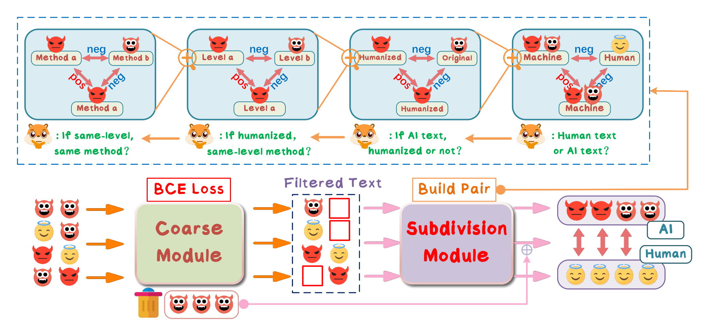

# HiDet

Code for the paper *"HiDet: Hierarchical AI Text Detection via Coarse Filtering and Multi-Grained Contrastive Learning"*.
(EMNLP 2026)



## Overview

HiDet gives AI texts a double check by decoupling detection into two modules:

1. **Coarse module** — a classifier-based detector (SimCSE-RoBERTa encoder + MLP head, trained with cross-entropy). For an input text `s`, it outputs `score(s) = P(human)`; samples with `score(s) <= T` (threshold `T = 0.35`) are directly labeled **AI**, the rest are routed to the second stage.
2. **Subdivision module** — a fine-grained detector for hard samples (human texts and humanized AI texts that escaped the first check), trained with **multi-grained contrastive learning** at four granularities plus the classification loss:

   - `m`: humanizing **method** (which of the humanizing strategies was used)
   - `e`: humanizing **level** (character / word / sentence / paragraph)
   - `u`: whether a humanizing strategy is **used**
   - `o`: **origin** of the text (Human or AI)

   The final loss is `L_final = λ·L_ca + (1−λ)·L_ce`, where `L_ca` aggregates the granularity-wise contrastive losses (Eq. 6-7 in the paper).

```
                    input text
                        |
              +------------------+
              |   coarse module  |  score = P(human)
              +------------------+
                 /            \
         score <= 0.35      score > 0.35
               /                \
        labeled AI        +--------------------+
                           | subdivision module |  multi-grained check
                           +--------------------+
                             /            \
                        labeled AI      labeled Human
```

The subdivision module can also be deployed **as a plug-and-play patch** on top of any existing detector (see [Patching existing detectors](#patching-existing-detectors)).

## Project structure

```
Hidet/
├── train.py                  # train the coarse / subdivision module
├── test.py                   # single-stage inference, saves per-sample predictions
├── src/
│   ├── dataset.py            # dataset with multi-granularity metadata (m, e, u, o)
│   ├── models.py             # CoarseDetector, SubdivisionDetector
│   └── text_embedding.py     # text encoder with pooling
├── utils/
│   ├── dataset_utils.py      # data loading, humanizing-method taxonomy
│   └── metrics.py            # ACC / Recall / F1 / AUROC / FPR@95%TPR / AUPR
├── tool/
│   ├── build_middle.py       # build subdivision data from coarse predictions
│   └── merge_results.py      # merge the two stages into final results
└── script/
    ├── train_coarse.sh       # step 1: train the coarse module
    ├── train_subdivision.sh  # step 2: build middle data + train subdivision module
    ├── cotest.sh             # two-stage inference
    └── patch.sh              # patch an existing detector with the subdivision module
```

## Requirements

- Python >= 3.9, a CUDA GPU
- PyTorch >= 2.1

```bash
pip install -r requirements.txt
```

If the Hugging Face hub is hard to reach from your network, set `HF_ENDPOINT=https://hf-mirror.com` when downloading models/datasets, or `HF_HUB_OFFLINE=1` once they are cached.

## Data

Organize each dataset as a folder of CSV splits under `data/`:

```
data/seqxgpt/
├── train.csv
├── valid.csv
└── test.csv
```

Each CSV needs three columns:

| column | description |
|---|---|
| `id` | unique sample id |
| `Generation` | the text |
| `label` | `human`, `machine_origin`, or a humanizing-method name (table below) |

Humanizing-method labels (grouped by level):

| level | labels |
|---|---|
| char | `spaceremoval`, `insertspace`, `wordcase_pct50`, `wordmerge`, `punctuationremoval`, `punctuationappend` |
| word | `typos`, `spellingerror`, `insertadv`, `mlmword` |
| sent | `appendirr`, `backtransent`, `repeatsent`, `mlmsent` |
| para | `reverse`, `backtran`, `paraphrase` |

For **Task 1** (human vs. original AI) the labels are only `human` / `machine_origin`; for **Task 2** (human vs. AI and humanized AI) the humanized AI texts carry their method label.

## Usage

Run everything from the repository root. Adjust `--path`, `--name` and the run directories in the scripts to switch datasets.

### 1. Train the coarse module

```bash
bash script/train_coarse.sh
```

equivalent to:

```bash
python train.py \
    --module coarse \
    --path data/seqxgpt --database_name train --test_dataset_name valid \
    --name coarse-seqxgpt \
    --total_epoch 30 --lr 2e-5 --warmup_steps 2000 --per_gpu_batch_size 32
```

The run (config, best checkpoint `model_classifier_best.pth`) is saved to `runs/coarse-seqxgpt_v0/` (auto-versioned).

### 2. Train the subdivision module

```bash
bash script/train_subdivision.sh
```

This (a) routes the training split through the trained coarse module, (b) builds the *middle* dataset from the routed samples (`tool/build_middle.py`, 80/20 train/test split, `valid.csv` keeps all routed samples), and (c) trains the subdivision module on it:

```bash
python train.py \
    --module subdivision \
    --path data/middle --database_name train --test_dataset_name test \
    --name subdivision-seqxgpt \
    --total_epoch 15 --lr 1e-5 --warmup_steps 1000 --per_gpu_batch_size 8 \
    --freeze_embedding_layer
```

### 3. Two-stage inference

```bash
bash script/cotest.sh
```

1. Coarse module scores the test set (`--threshold 0.35`) → `results/detail_result.csv`
2. Samples with `score > 0.35` form the middle test set → `data/middle_test/`
3. Subdivision module re-checks them → `results/second_detail_result.csv`
4. `tool/merge_results.py` merges both stages → `results/final_result.csv` and prints the final metrics (Human = positive class)

### Patching existing detectors

The subdivision module can be used as a plug-and-play patch on any detector (as done for DeBERTa, SimpleAI and RADAR in the paper):

1. Run your detector on `data/seqxgpt/train.csv` and `data/seqxgpt/test.csv`, and write its predictions as `results/detail_result.csv` with columns `id, true_label, pred_label` (add `score` = P(human) if available; otherwise routing falls back to `pred_label == 1`, i.e. samples the detector judges as human).
2. Build the middle training data from your detector's predictions on the training split and (re)train the subdivision module on it (adapt `script/train_subdivision.sh`, replacing the coarse-model step with your detector's `detail_result.csv`).
3. Run `bash script/patch.sh` to evaluate the patched detector.
